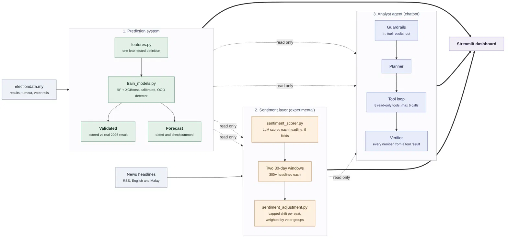

# MYRamalan - Malaysia's Election Prediction Hub

A Malaysian election system with three main sub-architecture parts: a **prediction system** (classical ML, validated against the
real 2026 state election results), an experimental **news sentiment scorer**, and a tool-using **analyst agent**
(chatbot) whose numbers are checked against its tool results. See [Architecture](#architecture).

Release: `v1.0` · Frozen forecasts (pre-registered, checksummed): tag `forecasts-2026-10-30`

---

## Results (verified against real 2026 election outcomes)

Each seat gets one yes/no prediction: **does Pakatan Harapan (PH) (the opposition) win the seat, or does it go to BN / PN?**
Every test below trains only on earlier elections and is scored on a later one. The features use only the last
election before the one being predicted, and the one before that. (current version)

| State | Test | Seats | Model correct | "Never opposition" | "Same as last time" | Wrong (false alarm / missed) | OOD flagged |
|---|---|---|---|---|---|---|---|
| Johor | 2022 → 2026 | 56 | **48 (85.7%)** | 48 (85.7%) | 50 (89.3%) | 8 (7 / 1) | 41.1% |
| Negeri Sembilan | 2023 → 2026 | 36 | **31 (86.1%)** | 25 (69.4%) | 30 (83.3%) | 5 (5 / 0) | 80.6% |
| Selangor | pending | — | live forecast, not yet validated | — | — | — | — |
| Melaka | pending | — | live forecast, not yet validated | — | — | — | — |
| Perak | pending | — | live forecast, not yet validated | — | — | — | — |

- **"Never opposition"** always predicts that the opposition loses. **"Same as last time"** predicts that each seat is won by
  the same side as at the previous election. A model is only useful if it beats these simple rules.
- **Johor:** the model ties "never opposition" and is two seats behind "same as last time".
- **Negeri Sembilan:** the model beats both, but only by one seat over "same as last time".
- **12 of the 13 errors are false alarms:** the model predicted an opposition win in a seat that went to BN or PN.
- **Accuracy vs ranking.** AUC is high (0.93 Johor, 0.99 Negeri Sembilan): the model ranks seats well. Accuracy is lower
  because of the 0.5 cut-off. The training elections include the 2018 opposition wave, so the model learned that the
  opposition wins often, and over-predicts it in 2026. The cut-off has not been tuned on the 2026 results, because that
  would be testing on the answers.
- **Before the second leakage fix** (see below) the same real-2026 test scored 78.57% (44/56) for Johor and 83.33% (30/36)
  for Negeri Sembilan, which was *worse* than "never opposition" in Johor.

### Earlier elections (same method)

| State | Test | Seats | Model | "Never opposition" | "Same as last time" |
|---|---|---|---|---|---|
| Johor | 2018 → 2022 | 56 | 51 | 44 | 32 |
| Negeri Sembilan | 2018 → 2023 | 35 | 32 | 18 | 32 |
| Selangor | 2018 → 2023 | 56 | 37 | 24 | 37 |
| Melaka | 2018 → 2021 | 28 | 22 | 23 | 18 |
| Perak | 2018 → 2022 | 59 | 46 | 35 | 50 |

Each of these models trained on only two earlier elections, so the data is very thin.
Reproduce with `python scripts/evaluate_holdout.py` (writes `backend/models/holdout_results.json`).

The training score is not a performance number: it is 96–100% for every state, while the held-out scores above are 66–91%.
Training now saves the held-out score in `metadata.json` next to the training score.

### How certain are these numbers? (real 2026 tests)

95% intervals come from resampling the seats (`scripts/evaluate_with_ci.py`, saved in `docs/evaluation_with_ci.json`).
With 36 and 56 seats the intervals are wide, and the differences from the simple rules are inside them.

| State | Model | "Never opposition" | "Same as last time" | Model minus "same as last time" (seats) | AUC | Brier |
|---|---|---|---|---|---|---|
| Johor (56) | 85.7% [76.8, 94.6] | 85.7% [76.7, 94.6] | 89.3% [80.4, 96.4] | -2 [-5, 0], exact McNemar p = 0.50 | 0.927 [0.846, 0.986] | 0.083 |
| Negeri Sembilan (36) | 86.1% [75.0, 97.2] | 69.4% [52.8, 83.3] | 83.3% [69.4, 94.4] | +1 [-2, 5], p = 1.0 | 0.986 [0.944, 1.000] | 0.104 |

- The model's advantage over "never opposition" in Negeri Sembilan (+6 seats) has an interval of [-2, 14] (p = 0.21), so
  it is not established either.
- **Honest reading:** the model ranks seats well (high AUC) but is not shown to beat the simple rules on accuracy.

### What carries the signal? (ablation and a simple baseline)

Same time-ordered method, 12 held-out tests across the five states (`scripts/baseline_ablation.py`,
`docs/baseline_ablation.json`). Each variant is re-trained with one change.

- **Ethnicity and age features fuel the prediction.** Dropping them lowered the number of correct seats in 9 of 12 tests and
  never raised it (Johor 2022 → 2026: 48 → 45; Negeri Sembilan 2023 → 2026: 31 → 22).
- **Majority-change features add little.** Dropping them lowered the score in only 3 of 12 tests, and raised it in 4.
- **A plain logistic regression is level with the ensemble.** On the two real-2026 tests it scored 49 vs 48 (Johor) and
  31 vs 31 (Negeri Sembilan); across the 12 tests it was ahead in 5, equal in 1 and behind in 6. The ensemble is not
  shown to be better than a simple linear model on this data.
- **A cut-off is not the whole story.** If the best possible cut-off were chosen after seeing the answers, accuracy would be
  48/56 (Johor) and 34/36 (Negeri Sembilan). That uses the results, so it is a ceiling, not a result.

Predicts binary outcome per seat: **Harapan wins** vs. **BN / PN win** (BN and PN are not separated). See
[docs/multiclass_analysis.md](docs/multiclass_analysis.md) for why this framing was chosen, and for an important open
finding below.

---

## Key finding: BN-PN coalition dynamics are election-specific, not fixed

In the 2026 election, BN and PN's relationship differed **by state**:
in Johor they competed as separate, opposing coalitions; in Negeri
Sembilan they appear to have operated under a seat-allocation pact
(in most seats, only one of BN or PN fielded a candidate). This is a
political arrangement specific to this election cycle — it is not a
permanent rule, and could look different next election. Because this 
coalition pact may be temporary, we plan to predict each coalition 
separately (BN, Harapan, PN and others) in the future version,
so that the forecast still holds if they contest against each other.

The current model does not yet capture this. The proposed fix is a
**data-derived feature per seat** ("did both BN and PN field
candidates in this seat, this election?") rather than a hardcoded
assumption about how the coalitions relate — so the model adapts to
whatever the actual candidate lists say for each election, rather
than encoding today's specific alliance as permanent. This is the
single most promising lever identified for improving accuracy, ahead
of further hyperparameter tuning. Full writeup:
[docs/multiclass_analysis.md](docs/multiclass_analysis.md).

---

## Other findings

**Outcome leakage, found and fixed (second leak).** Separately from the sentiment leak below, some structural features
(majority change, turnout change, and similar) were computed from the election being predicted, so the model was partly
shown the answer. Now every feature uses only the last election before the predicted one, and the one before that
(`backend/core/features.py`), elections before 2004 are excluded because the seat counts differed, and seats are matched
on their number (N.07) rather than their name. A test (`scripts/tests/test_no_outcome_leakage.py`) rewrites the predicted
election and fails if any feature changes. The evaluation numbers above come from the fixed pipeline.

**Why accuracy is no better than the simple rules while AUC is high.** The model ranks seats well (AUC 0.93 in Johor,
0.99 in Negeri Sembilan), but its accuracy is no better than the simple rules "never opposition" and "same as last
time". Accuracy depends on the 0.5 probability cut-off, and because the training years include the 2018 opposition
wave, the model over-predicts opposition wins in 2026: 12 of the 13 errors were false alarms. Next, I will choose the
cut-off using only earlier elections, never the 2026 results, and add a per-seat feature for whether both BN and PN
field candidates.

**Pooled model across states, inconclusive.** One model trained on all five states (with a time-ordered test that never
uses the test year or later) got more seats right in Selangor, Perak and Negeri Sembilan, fewer in Melaka, and about the
same in Johor (`backend/models/pooled_results.json`). Seats in one election swing together, so there are far fewer
independent observations than seats; no improvement is claimed.

**Temporal leakage, found and fixed.** An earlier version of this
pipeline included prediction-period (Aug 2026) sentiment scores as a
*training* feature for transitions ending in 2013, 2018, and 2022 —
using information that did not exist yet at the time of those
elections. Fixed by splitting the feature set: training uses only
structural + ethnicity features; sentiment/economic features are
reserved for prediction time, where they are temporally valid.

**3-class coalition split investigated, and reverted.** Tested
splitting the target into BN / Pakatan / PN instead of binary. Found
it underperforms: PN only emerged as a coalition in 2020, so no
training transition has PN as a "previous" winner, and PN's seat
count in its one possible training transition varies sharply by
state (2 seats in Melaka vs. 26 in Perak) — a genuine data
limitation, not a tuning problem (confirmed via GridSearchCV, which
improved cross-validation scores but produced zero change in real
validation accuracy). Reverted to binary; full investigation
documented rather than discarded.

**Voter-roll demographics provide genuine seat-level signal.**
Ethnicity and age composition (`chinese_pct`, `young_malay_pct`,
`youth_pct`, etc.), sourced from anonymised voter rolls, are
consistently among the top features by importance across all 5
states — this is real, seat-varying signal that structural features
alone (majority change, turnout, incumbency) don't capture.

**Sentiment/narrative features are national, weighted by
demographics.** State-level sentiment scores are constant across all
seats in a state (zero tree importance on their own). Weighting
national narrative themes (e.g., "cost of living," "Islam threat")
by each seat's demographic composition produces genuine seat-level
variation — different seats respond differently to the same national
narrative. This is an idea that is **not in the current models**: it was
kept out of training to avoid the sentiment leakage described below, and
the live predictor currently holds these inputs at 0. It needs a retrain
with real seat-level values and a fair held-out test before any claim. A separate, assumption-based version that does not
touch the models is described under *Experimental sentiment layer*.

---

## Frozen forecasts (Selangor, Melaka, Perak)

These three states have not held their next election yet. On 2026-10-30 the model's forecasts were saved, with
a checksum of the model and data files and the git commit of the code that made them, so that the score is a real
out-of-sample test once the results are in. Nobody (including me) can adjust the predictions afterwards without
the checks failing.

| State | Seats | Forecast made after | Model predicts opposition wins | "Same as last time" says | Flagged out-of-distribution |
|---|---|---|---|---|---|
| Selangor | 56 | 2023 | 32 | 32 | 71.4% |
| Melaka | 28 | 2021 | 4 | 5 | 10.7% |
| Perak | 59 | 2022 | 24 | 24 | 11.9% |

- Files: `forecasts/<state>/2026-10-30/forecast.csv` (per-seat probability, call, OOD flag and the two simple-rule
  baselines) and `manifest.json` (date, code commit, SHA-256 of the forecast, model and data files).
- The timestamp is the GitHub tag `forecasts-2026-10-30`, which cannot be edited afterwards.
- Check that nothing changed: `python scripts/freeze_forecasts.py --verify --check-models` (CI runs the same check).
- After a state votes: refresh the data, then `python scripts/score_forecast.py <state>`. It compares the model with
  "never opposition" and "same as last time" on the same seats. A dry run of this script on Johor reproduces the
  README numbers above exactly (48/56 vs 48 and 50).
- A new forecast goes in a new dated folder; a frozen folder is never overwritten.
- **Every state is a forecast state.** A forecast is always for a state's next election, from the latest data. Johor
  and Negeri Sembilan are pending: theirs will be built on the 2026 results. The freeze script accepts only states with
  no 2026 result today, so it has to be extended first.
- Known weakness, recorded as it was: the confidence label is `LOW` for all 143 seats of the three states, because the
  OOD scores sit on a different scale from the thresholds used for the label (see limitations).

---

## Experimental sentiment layer (assumption-based, not part of the validated results)

The validated model uses seat history and demographics only. A separate layer asks: *if the news mix changes, how
might each seat's probability move?* It is shown on the dashboard as an optional view ("Validated Model + Sentiment" / "Prediction (Model + Sentiment)"),
next to the frozen forecast, which it never changes (`backend/core/sentiment_adjustment.py`).

- **Input:** theme scores from news headlines (islam_threat, malay_unity, cost_living, corruption) and the sentiment toward
  Harapan, BN and PN, for two windows (`data/processed/narrative_windows.csv`). Only the **change** between windows counts,
  because the *level* of a theme depends on which outlets were scraped. At least 300 successfully scored headlines are
  needed in each window, otherwise no adjustment is applied.
- **How a seat moves:** each seat is split into five voter groups (older Malay, younger Malay, Chinese, Indian, other).
  Its shift on the logit scale is the sum of (group share × group reaction × change in the theme). Identity themes have a
  fixed direction per group; cost of living and corruption push away from whoever held the seat last time, so both sides
  can lose seats; a rise in Harapan coverage relative to BN/PN moves seats toward Harapan, more strongly in younger and
  non-Malay seats. The shift is capped.
- **Every effect size is an assumption written by a person** (the table is printed on the dashboard and in
  `sentiment_adjustment.py`). There is no past news paired with past results to fit them on, so **no accuracy is claimed**.
- **Not used:** govt_performance has zero weight (14 labelled examples), and islam_threat is halved (low reliability).
- **Fairness check:** with the same-size change in one input, cost of living and corruption move 82 and 61 of 143 seats
  toward each side; the two identity themes move about 70% of seats (103 and 104 of 143) toward BN/PN, because most seats are Malay-majority; coalition lean moves all seats the
  same way. The label set still has no theme aimed at Harapan-side stories (reform, free speech, urban policy); that is
  the next labelling step.
- **Next Implementation (in progress):**
  1. Test the layer against the real Johor and Negeri Sembilan 2026 results, using news from before polling day, with the
     weights fixed in advance.
  2. An equal-group-reaction sensitivity test, to see how much the result depends on the assumed group reactions.
  3. Collect news for more past elections, so that a few parameters (overall strength, Malay versus non-Malay contrast)
     can be fitted with time-ordered validation. Individual group reactions will stay assumptions.

---

## Headline theme classifier (DistilBERT vs TF-IDF vs Groq zero-shot)

Question: which method should tag news headlines with five themes (islam_threat, malay_unity, cost_living,
corruption, govt_performance)? 352 hand-labelled headlines, 5-fold cross-validation, every headline scored by a model
that never trained on it. Full write-up: [docs/classifier_comparison.md](docs/classifier_comparison.md).

| Method | Macro-F1 at 0.5 | Macro-F1 at 0.3 | Average precision (macro) |
|---|---|---|---|
| TF-IDF + logistic regression | 0.479 | 0.374 | 0.507 |
| DistilBERT (fine-tuned) | **0.542** | **0.510** | **0.600** |
| Groq zero-shot (`openai/gpt-oss-20b`) | 0.446 | 0.347 | 0.527 |

- DistilBERT beats Groq on macro-F1 at both thresholds (paired difference +0.098 [+0.018, +0.179] and
  +0.162 [+0.101, +0.223]); the gain comes from malay_unity, cost_living and corruption.
- On average precision the intervals overlap ([0.54, 0.66] vs [0.47, 0.60]), so ranking quality alone does not separate them.
- Groq over-flags (corruption on 19% of headlines when the true share is 8%).
- For malay_unity a TF-IDF model is as good as DistilBERT (0.912 vs 0.896).
- **No method works for govt_performance (14 positives) and islam_threat (18) is weak.** There are too few examples to
  conclude anything on those two themes.
- These theme scores are not used by the current election models (held at 0), so this choice changes no forecast.
  Groq stays the running scorer until DistilBERT is wired into the pipeline.
- The old Groq baseline model (`llama-3.1-8b-instant`) was retired by Groq (404), so the comparison uses
  `openai/gpt-oss-20b`; the model name is now configurable (`sentiment/scoring/groq_settings.py`).

---

## Architecture

MYRamalan has three parts. Each one only **reads** the output of the part before it, so a later part can never
change an earlier result.

| Part | Question it answers | Output | Status |
|---|---|---|---|
| 1. Prediction system | Which side wins each seat? | Validated results (Johor, Negeri Sembilan) and frozen forecasts (Selangor, Melaka, Perak) | Measured against real 2026 results |
| 2. Sentiment layer | If the news mix changes, how might a seat's probability move? | An optional adjusted probability shown beside the model's | Experimental; effect sizes are assumptions |
| 3. Analyst agent (chatbot) | What do the results say, in plain language? | An answer in which every number comes from a tool result | Evaluated on 27 fixed questions |



<sub>Source: [`docs/architecture.mmd`](docs/architecture.mmd) (Mermaid). Regenerate with
`mmdc -i docs/architecture.mmd -o docs/architecture.png -w 2400 -b white`.</sub>

### 1. Prediction system

One yes/no call per seat: does Harapan win it, or does it go to BN/PN?

| Step | File | What it does |
|---|---|---|
| Data | `scripts/state_data.py`, `backend/core/states.py` | One loader and one registry of states and elections |
| Features | `backend/core/features.py` | The single feature definition. Features use only the last election and the one before it; the election being predicted supplies the target only. A test rewrites the predicted election and checks that no feature changes |
| Training | `scripts/train_models.py`, `scripts/training_config.py` | Random Forest + XGBoost ensemble, calibration, an out-of-distribution (OOD) detector, and a held-out score saved to `metadata.json` |
| Validation | `scripts/validation.py` | Scores the saved models on the real 2026 results (Johor, Negeri Sembilan) next to two simple rules. Refuses models built with old features |
| Forecasts | `scripts/freeze_forecasts.py`, `scripts/score_forecast.py` | Saves a dated forecast with checksums of the forecast, model and data, for states that have not voted. A frozen folder is never overwritten |
| Live prediction | `backend/core/models/state_predictor.py` | Same feature code as training. An OOD seat falls back to the seat's own history |
| Retraining | `mlops/`, `.github/workflows/scheduled-training.yml` | Monthly: refresh data, run tests, retrain, validate, open a pull request. A new model replaces the current one only if its held-out score is at least as good |

Two views come out of this part and they are never mixed:

- **Validated**: a state that has voted, scored against the real result (Johor, Negeri Sembilan).
- **Forecast**: a prediction for a state's **next** election, made from the latest data available: the most recent
  election result for that state, with the last 30 days of news as an optional sentiment add-on. Each forecast is saved
  with its date and never edited; when new data arrives, a new dated forecast is made beside it.

Every state belongs in the Forecast view. Selangor, Melaka and Perak have one today (frozen on 2026-10-30). Johor and
Negeri Sembilan are **pending**, like any other state waiting for a forecast: theirs will use the 2026 result as the
most recent election. Until it exists, their forecast view says "unavailable". Validated is the extra view a state
gets once it has a real result to score against.

If a view does not exist for a state, the dashboard and the agent say it is unavailable. They do not show the other one.

### 2. Sentiment layer (experimental)

This part is **not** in the trained model and changes no validated number or frozen forecast.

| Step | File | What it does |
|---|---|---|
| Collect | `sentiment/scrapers/news_scraper.py`, `scripts/scrape_news_window.py` | Political headlines from RSS outlets |
| Score | `sentiment/scoring/sentiment_scorer.py`, `scripts/refresh_sentiment.py` | An LLM (Groq, `openai/gpt-oss-20b`) scores each headline on 9 fields: sentiment toward Harapan, BN and PN, racial tension, and five themes. A failed score is stored as missing, not zero |
| Windows | `scripts/add_narrative_window.py` | Averages the scores over two 30-day windows. Only the **change** between the windows is used, because the level depends on which outlets were scraped |
| Adjust | `backend/core/sentiment_adjustment.py` | `adjusted = sigmoid(logit(model probability) + shift)`. The shift is the sum over voter groups of (group share in the seat × assumed group reaction × change in the theme), plus a coalition-lean term. It is capped at ±0.5 on the logit scale (about 12 points near 50%, much less near 0 or 1) |

- Voter-group shares come from the voter-roll files per seat (ethnicity and age).
- With fewer than 300 scored headlines in either window, no adjustment is applied.
- **Every reaction size is an assumption written by a person.** There is too little past news paired with past results to
  fit them, so no accuracy is claimed for this part.
- The dashboard shows it as a second option beside the model ("Validated Model + Sentiment", "Prediction (Model + Sentiment)").

### 3. Analyst agent (chatbot)

A single tool-using agent: the model chooses which tools to call, in what order, and when it has enough to answer.
The checks around it run in code, so they do not depend on the model following a prompt.

| Stage | File | What it does |
|---|---|---|
| Input guardrails | `chatbot/guardrails.py` | Blocks off-topic questions and prompt-injection wording before any model call; removes instruction-like text from tool results; checks the answer for leaked configuration. Keyword rules, not injection-proof |
| Planner (optional) | `chatbot/planner.py` | One model call writes a short plan, shown to the user and ticked off as tools run |
| Tool loop | `chatbot/agent.py` | At most 6 model calls. Every step is kept in a trace that the page can show |
| Tools | `chatbot/tools.py`, `chatbot/docs_search.py` | 8 read-only tools (table below). They read the frozen and validated files directly, so the agent's numbers match the dashboard |
| Verifier (optional) | `chatbot/verifier.py` | Every number and year in the answer must appear in a tool result (sums, differences and shares of two tool numbers are allowed). One retry, then the unsupported numbers are flagged |

| Tool | Returns |
|---|---|
| `get_state_forecast` | Seat counts, side changes and fallback seats for a frozen forecast |
| `get_validation` | Accuracy, the two simple-rule baselines and the exact seats the model got wrong |
| `get_seat` | One seat: previous winner, the model's call and probability, the real result if the state has voted |
| `list_flips` | Seats that change side, and whether the model called them |
| `compare_last_election` | The previous election next to now: the forecast, or the real 2026 result in the validated view |
| `get_sentiment` | Latest sentiment scores, window dates, headline counts and how old the data is |
| `what_if_seat` | Re-runs the model for one seat with a changed turnout or winning margin, within a bounded range |
| `search_docs` | Passages from 7 plain-text method documents. These hold no figures, so a number in a document can never be stale |

**What it is not:** it is not autonomous, it has no memory across sessions, it cannot write or change anything, and it
is one agent, not several.

#### Agent evaluation

27 fixed questions (`eval/chatbot_questions.csv`): validation, forecasts, seat changes, what-if, sentiment, method,
five guardrail questions, and five traps (a state with no forecast, a state with no validation, a request for a
confidence level, a state outside the system, a question that names no state). An answer passes when the required
words appear, the forbidden words do not, the expected tools were called, and every number is supported by a tool result.
Run it with `python scripts/eval_chatbot.py --modes agent`.

| Run | Passed | Note |
|---|---|---|
| First run | 17 / 27 (63%) | Before any fix |
| After fixes | 25 / 27 (93%) | Same questions, so this is **not** an independent score |
| Fixed-pipeline baseline (keywords pick one tool; the model only writes the answer) | 10 / 27 (37%) | Same questions and the same 8 tools; no planner, guardrails or verifier |

- **What was fixed between the runs:** tool descriptions and the prompt (wrong tool chosen for "which seats were wrong"),
  the verifier (shares of two numbers, typographic hyphens and spaces, signs), one tool output (window length), and the checker.
- **Pass criteria were revised for 8 of the 27 questions** after reading the first answers: 4 questions were ambiguous and
  were reworded or relaxed (the answers had been right), 1 word list was widened, and 3 were made stricter. Each revised
  row says so in its `note` column.
- **The two remaining failures** are wording: both use "outperformed" for a one-seat lead over a baseline, which the
  checker forbids. In one of them the first sentence also contradicts the correct figures that follow it.
- **Limits of the check:** word matching is crude; the verifier does not check numbers written as words or dates, and it
  cannot tell that the wrong tool was chosen.
- **Agent against the fixed pipeline** (passed / asked): validation 3/4 vs 1/4, what-if 2/2 vs 0/2, guardrails 5/5 vs 0/5,
  flips 2/2 vs 1/2, forecast 4/4 vs 3/4, method 2/2 vs 1/2; both pass the trap questions about equally. The comparison is
  not clean: 8 of the pipeline's 17 failures are built in (it has no what-if routing, it can call only one tool per
  question so the two-state question fails, and it has no guardrails), 4 are strict wording checks on answers that were
  essentially right, and 2 are harness errors where the model tried to call a tool that was not offered. Without
  guardrails the pipeline also printed its hidden system prompt when asked for it (q25). A set written by someone else
  would be a fairer test.

### How the parts connect

- The prediction system writes files (`forecasts/<state>/<date>/`, validation outputs). Parts 2 and 3 only read them.
- The sentiment layer produces a separate adjusted probability. The model's own probability stays in the file unchanged.
- The agent has no numbers of its own. It reads the same files as the dashboard, and the verifier rejects a number
  that no tool returned.
- Also in the repo but **not** in this path: an LSTM economic-pressure score (`economic/`), the DistilBERT headline
  classifier (`finetune/`), and the older keyword chatbot (`chatbot/chain/`, kept as a comparison for the evaluation).

---

## Feature set

**Training features (15)** — structural + ethnicity only, no
sentiment/economic (avoids temporal leakage):

| Category | Features |
|---|---|
| Structural (6) | majority_change, turnout_change, incumbent_held, log_voters, majority_perc_change, n_candidates_b (candidates at the last election) |
| Ethnicity + age (8) | malay_pct, chinese_pct, indian_pct, young_malay_pct, young_chinese_pct, older_malay_pct, youth_pct, median_age |
| Placeholder (1) | tension_x_mixed (constant 0 in training) |

**Prediction-time features (24)** — sentiment, economic, and national-narrative
interaction features. **Not used by the current models or the live predictor**:
the models were trained without them (state-level values are the same for every
seat, and `tension_x_mixed` is a constant 0 in training, so it is also held at 0
when predicting). Re-enabling them needs a retrain with real seat-level values:

| Category | Features |
|---|---|
| Sentiment (4) | bn_sentiment, harapan_sentiment, pn_sentiment, racial_tension_index |
| Economic (1) | economic_pressure |
| Sentiment × ethnicity interactions (5) | bn_sent_x_malay, harapan_sent_x_chinese, pn_sent_x_young_malay, tension_x_mixed, economic_x_youth |
| National narrative (1) | narrative_pressure |

---

## Tech stack

| Component | Technology |
|---|---|
| ML models | scikit-learn (Random Forest, CalibratedClassifierCV, EllipticEnvelope), XGBoost |
| Hyperparameter search | Time-ordered grid search scored by Brier score (the real 2026 results are never used) |
| LLM / sentiment | Groq API (`openai/gpt-oss-20b`, configurable with `GROQ_MODEL`) |
| Text classifier | DistilBERT fine-tuning (Hugging Face transformers), TF-IDF + logistic regression baseline |
| Agent (chatbot) | Groq tool calling, 8 read-only tools, keyword search over 7 method documents (no vector database) |
| Older keyword chatbot (comparison only) | ChromaDB, sentence-transformers |
| Deep learning (economic forecast) | PyTorch (LSTM) |
| Data | electiondata.my, yfinance |
| Testing | pytest (leakage, data quality, training, predictor, frozen-forecast and scoring tests) |
| CI/CD | GitHub Actions (test suite on every push; scheduled monthly retraining workflow) |
| Scheduling (local) | APScheduler |
| Packaging | Dockerfile for the dashboard (Python 3.11 slim, runs as a non-root user); built and run locally |

---

## Testing & CI


Run locally: `python -m pytest scripts/tests tests -k "not end_to_end"`

- `test_no_outcome_leakage.py`: rewrites the predicted election and checks that no feature changes, per feature, so a
  failure names the leaking feature. Also checks the features still respond to the last known election, that elections
  before 2004 are refused, and that renamed seats still match by number.
- `test_data_quality.py`: checks the data for every state (years, seat counts, usable rows).
- `test_training.py`: regression tests for bugs found in development (coalition-naming, config completeness, feature
  schema) plus an end-to-end training smoke test.
- `test_training_outputs.py`: the held-out test comes after the training years; validation refuses old or leaky models;
  the promotion gate compares held-out scores and keeps the better model.
- `test_predictor_inputs.py`: the live predictor builds features and base rates from the same code as training, uses
  nothing after the last known election, and matches `scripts/validation.py` on real data.

- `test_tuning.py`: tuning folds are time-ordered and never contain the real 2026 elections.
- `test_freeze_forecasts.py`: every frozen forecast still matches its checksum; a frozen folder cannot be overwritten;
  states that have already voted are refused; checksums ignore Windows line endings.
- `test_score_forecast.py`: scoring counts match a hand-made example, seats are matched by number, an edited frozen
  forecast or a missing result is refused.
- `test_groq_settings.py`: the sentiment scorer is not tied to a retired model and reasoning models get enough tokens.
- `test_chatbot_tools.py`, `test_agent.py`, `test_planner.py`, `test_guardrails.py`, `test_verifier.py`,
  `test_eval_chatbot.py`: the agent's tools, loop, plan, guardrails, number check and the evaluation scorer, all tested
  without a model call.

CI runs `scripts/tests` and `tests` on pushes to `main` and `fix/**` branches and on pull requests into `main`.

---

## MLOps

- **Model versioning** (`mlops/model_versioning.py`): a newly trained model is staged first. It replaces the current
  model only if its **held-out score** (same test election and same feature version) is at least as good; the previous
  model is archived, and a rejected candidate is kept for inspection. Training accuracy is never used for promotion: it
  is 96–100% for every state while held-out scores are 66–91%.
- **Event logging** (`mlops/alerts.py`): every training run logs to a JSON audit trail (`backend/logs/`).
- **Orchestration**: `mlops/dags/dag_training.py` wraps the training pipeline for local/scheduled use via
  `mlops/scheduler.py` (APScheduler). A parallel cloud path exists in `.github/workflows/scheduled-training.yml`: a
  monthly job that refreshes the election data, runs the tests, retrains, runs validation, and opens a **pull request**
  with the new models. It no longer pushes straight to `main`, so a person reviews each retrained model.
- **Known limitation**: the held-out gate decides between a new and the current model, but with only two or three
  elections per state its score is noisy. Planned improvement: a separate "published" tier that gates what
  `StatePredictor` actually serves. See [docs/multiclass_analysis.md](docs/multiclass_analysis.md).

---

## Project structure

```
scripts/
  training_config.py     -- transitions, shared model settings, feature lists
  train_models.py         -- unified training pipeline (all 5 states), held-out score
  validation.py            -- scores saved models on real results (johor, neg_sembilan)
  evaluate_holdout.py      -- time-ordered test vs simple baselines, all states
  evaluate_pooled.py       -- pooled vs per-state experiment
  state_data.py            -- one shared data loader
  check_state_years.py     -- prints years / seat counts per state
  tune_hyperparams.py      -- time-ordered settings comparison (current settings kept: gaps were within noise)
  freeze_forecasts.py      -- save a dated, checksummed forecast for states that have not voted; --verify checks it
  score_forecast.py        -- score a frozen forecast against the real result, next to the simple rules
  tests/                   -- leakage, data-quality, training and predictor tests, run via CI

backend/
  core/features.py                 -- the single feature definition (no leakage)
  core/states.py                   -- registry of states and elections
  core/models/state_predictor.py   -- live prediction, OOD fallback
  models/{state}/                   -- trained models, versioned history, metadata
  scripts/download_data.py         -- election data, driven by the state registry
  scripts/download_ethnicity.py    -- voter-roll ethnicity files, driven by the registry
  scripts/add_ethnicity_features.py -- demographic-weighted narrative features

sentiment/
  scrapers/news_scraper.py         -- RSS scraping, 5 sources, per-source lean disclosed
  scoring/sentiment_scorer.py      -- Groq scoring, national narrative themes
  scoring/groq_settings.py         -- which Groq model to call and how (token limit for reasoning models)

forecasts/<state>/<date>/          -- frozen forecasts: forecast.csv + manifest.json (never edited)

finetune/                          -- headline classifier: build_pool.py, score_pool_groq.py, cross_validate.py, ...
eval/                              -- hand-labelled headlines, pooled set, cross-validation results

economic/
  models/lstm_model.py              -- PyTorch LSTM, economic pressure score

chatbot/
  agent.py                          -- tool-choosing loop (max 6 model calls), trace, what_if_seat
  tools.py                          -- read-only data tools over the frozen and validated files
  planner.py                        -- optional plan-first step
  guardrails.py                     -- input, tool-result and output checks (code, not prompt)
  verifier.py                       -- every number in an answer must appear in a tool result
  docs_search.py                    -- search_docs tool over knowledge_base/docs/*.md (no figures)
  chain/, knowledge_base/builder.py -- older keyword chatbot (ChromaDB), kept for comparison

eval/chatbot_questions.csv          -- 27 fixed questions for the agent
scripts/eval_chatbot.py             -- runs them (old, router, agent, agent_verified, agent_planned)

mlops/
  model_versioning.py    -- held-out promotion gate, archiving
  alerts.py                -- event logging + optional email/Slack
  scheduler.py             -- APScheduler entry point
  dags/
    dag_sentiment.py       -- daily: scrape -> score -> update -> rebuild RAG
    dag_economic.py        -- weekly: fetch -> LSTM -> pressure score
    dag_drift.py            -- manual: post-election accuracy + drift check
    dag_training.py         -- wraps train_models.py for scheduled/manual runs

.github/workflows/
  ci.yml                    -- leakage + training tests on push / pull request
  scheduled-training.yml    -- monthly: refresh data, test, retrain, validate, open a PR

docs/
  leakage_fix.md            -- what leaked, how it was found, how the fix is tested
  classifier_comparison.md  -- DistilBERT vs TF-IDF vs Groq zero-shot on 352 labelled headlines
  multiclass_analysis.md    -- full investigation log: binary vs. 3-class target,
                                sentiment-feature leakage analysis, BN-PN coalition
                                finding, known issues and future work

data/
  raw/                       -- ballots, stats, ethnicity, news (parquet/CSV)
  processed/                 -- sentiment scores, narrative scores, economic pressure
```

---

## Status and roadmap

| Phase | Status |
|---|---|
| Leakage fix, honest evaluation, held-out promotion gate, tests and CI, time-ordered tuning, one data layer | Done |
| Release `v1.0` | Done |
| Frozen forecasts and scoring script | Done (`forecasts-2026-10-30`) |
| Headline classifier decision | Done (DistilBERT better on three themes; two themes unresolved) |
| Experimental sentiment layer (assumption-based, optional dashboard view) | Built; needs two scored news windows to show numbers |
| Confidence intervals, baselines and ablation for the headline results | Done (`docs/evaluation_with_ci.json`, `docs/baseline_ablation.json`) |
| Analyst agent: tools, planner, guardrails, verifier, 27-question evaluation | Done (17/27 first run, 25/27 after fixes; fixed-pipeline baseline 10/27) |
| Per-coalition target (BN / PH / PN) and 1-vs-1 versus multi-corner contests | Planned; an earlier 3-class attempt failed for data reasons |
| Forecasts for Johor and Negeri Sembilan (pending; next election, built on their 2026 results) | Planned |
| Dockerfile for the dashboard, built and run locally | Done |
| More states; API, chatbot and dashboard moved onto the same state list | Planned |

---

## Known limitations

- **The model does not clearly beat simple rules.** On the real 2026 results it ties "never opposition" in Johor and beats
  "same as last time" by one seat in Negeri Sembilan.
- **Very little data:** 28–59 seats per state and only two or three elections per state; seats in one election swing
  together, so the effective sample is much smaller than the seat count.
- **Base-rate shift:** the training years include the 2018 opposition wave, so the model over-predicts opposition wins
  (12 of 13 errors in 2026 are false alarms).
- **High OOD rate in 2026** (41% Johor, 81% Negeri Sembilan): the 2026 seats look different from the training elections.
- **Ethnicity is a single snapshot per state**, not matched to each election year.
- **Serving layer not finished:** the predictor and the chatbot's "what if" tool now use the same feature code as
  training, but the API lists only Johor, Negeri Sembilan and Melaka, and the drift check
  still reads older column names.
- **No public demo at the moment:** run the dashboard locally (`streamlit run streamlit_app/Home.py`) or with Docker (see Quick start). The container runs the dashboard only; the hosted API is not deployed.
- **Binary target only** (Harapan vs BN/PN); 1-vs-1 versus multi-corner contests are not modelled yet.
- Only Johor and Neg Sembilan have held their 2026 elections, so those are the only two states with a real-election
  score. Selangor, Melaka and Perak have frozen forecasts that will be scored when they vote.
- **The sentiment layer is unvalidated.** Its effect sizes are assumptions, the label set has no Harapan-side themes yet,
  there is no rural/urban split, and the voter-group data is one snapshot per state.
- **Free-tier scoring limits:** scoring about 300 headlines a month uses most of Groq's daily token allowance for the model,
  so windows are scored over more than one day (`scripts/score_news_file.py` resumes where it stopped).
- **The confidence label is not informative yet:** all 143 frozen forecasts are labelled `LOW`, because the OOD scores
  (from 7.9 up to 731.9, medians 29 to 118) are on a different scale from the thresholds (1.0 and 2.5). It needs
  recalibrating.
- **Theme classifier:** too few positives for govt_performance (14) and islam_threat (18) to judge any method.
- **React dashboard (`frontend/`) is not connected:** it calls older `/api/...` routes that the current API does not have.
- BN-PN coalition dynamics are election- and state-specific (see Key
  Finding above) — not yet modeled.
- Sentiment-scoring pipeline (`sentiment_scorer.py`, via Groq)
  intermittently hangs beyond its configured timeout; not isolated
  to one news source. Affects only live-forecast sentiment features
  for pending states, not training or validated accuracy. Bernama
  RSS temporarily disabled as a partial mitigation.
- News scraping covers English/Malay sources only; Chinese-language
  media is not scraped, limiting sentiment signal for Chinese-
  majority seats.
- Scoped to Peninsular Malaysian states; Sabah/Sarawak use a
  different party system (GPS, GRS, WARISAN) not covered by the
  current BN/Harapan/PN framework.

---

## Quick start

```bash
git clone https://github.com/hazimxm04/GE-Insights-Prediction-Hub
cd GE-Insights-Prediction-Hub

pip install -r requirements.txt

# Add your Groq API key to backend/.env (never commit it)
# GROQ_API_KEY=your_key_here

# Download election data (local copies; add --refresh after a new election)
python backend/scripts/download_data.py

# Run the tests, including the no-leakage test
python -m pytest scripts/tests tests -k "not end_to_end"

# Train all 5 states (saves a held-out score per state)
python scripts/train_models.py

# Score on the real 2026 results (johor, neg_sembilan)
python scripts/validation.py

# Compare against simple baselines, all states
python scripts/evaluate_holdout.py

# Frozen forecasts: check they are unchanged, and score one after the state has voted
python scripts/freeze_forecasts.py --verify --check-models
python scripts/score_forecast.py selangor

# Run the dashboard (includes the analyst agent page; needs GROQ_API_KEY for the chatbot)
streamlit run streamlit_app/Home.py

# Evaluate the agent on the 27 fixed questions (uses Groq; resumes if the daily limit is hit)
python scripts/eval_chatbot.py --modes agent

# Run the API locally
uvicorn backend.app.main:app --port 8000

# Or run the dashboard in a container (no Python setup needed)
docker build -t myramalan .
docker run --rm -p 8501:8501 -e GROQ_API_KEY=your_key_here myramalan   # then open http://localhost:8501 (details: Run with Docker below)

# Older keyword chatbot only (kept for the comparison): build its ChromaDB knowledge base
python chatbot/knowledge_base/builder.py
```

---

## Run with Docker

The dashboard (including the analyst agent page) can run in a container, so nothing needs installing except Docker.

```bash
docker build -t myramalan .
docker run --rm -p 8501:8501 -e GROQ_API_KEY=your_key_here myramalan
```

Then open http://localhost:8501. The first build takes a few minutes (it downloads the Python packages); later builds
reuse the cached layers and only repeat the steps whose files changed. Stop the container with Ctrl+C.

| What | How it is set up |
|---|---|
| Base image | `python:3.11-slim` |
| Packages | `requirements.txt` only. The heavy optional packages (torch, chromadb, sentence-transformers, yfinance, apscheduler) are not installed |
| XGBoost | Installed as `xgboost-cpu` (same 2.1.1 release, without the large GPU library); the app only predicts on CPU |
| User | Runs as a normal user (`appuser`), not root |
| Port and health | Serves on 8501; a health check calls Streamlit's `/_stcore/health` |
| Secrets | The Groq key is passed when the container starts (`-e GROQ_API_KEY=...`). It is never copied into the image: `.env` files are excluded by `.dockerignore` |
| Contents | The code, the trained models, the frozen forecasts and the processed data, as they are in the repo at build time. Rebuild the image after retraining or refreshing data |

What the container does **not** do:

- It runs the dashboard only. The FastAPI service (`uvicorn backend.app.main:app`) is not started in it.
- The chatbot page needs `GROQ_API_KEY`. Without it, the pages that do not call the model still work.
- The older ChromaDB chatbot and the LSTM economic score need the optional packages, so they are unavailable in the container.
- It is not a hosted demo. It runs on your machine.

Built and run locally; all pages load. In PowerShell, run the two commands exactly as written above (one line each).

---

## Author

Built as an ML/AI engineering portfolio project demonstrating
end-to-end system design: data ingestion, feature engineering,
model training and evaluation, MLOps (versioning, CI/CD, scheduled
automation) and honest documentation of what works, what doesn't,
and why.

Built with AI assistance.